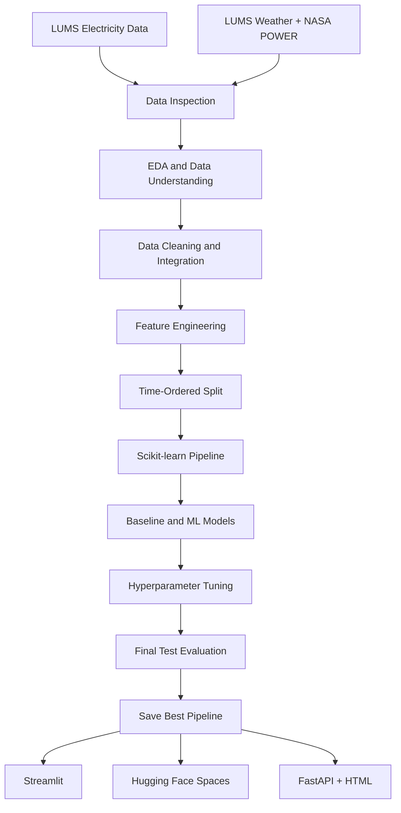

# ⚡ BijliCast — Project Plan

> **Weather-Aware Household Electricity Consumption Forecasting in Pakistan**
> Course: **CT-378** · Task: **Time-series regression** · Target: `next_hour_energy_kwh`

---

## 📌 Table of Contents

1. [Project at a Glance](#1--project-at-a-glance)
2. [Guiding Principles](#2--guiding-principles)
3. [Repository Structure](#3--repository-structure)
4. [Folder-by-Folder Guide](#4--folder-by-folder-guide)
5. [Root-Level Files](#5--root-level-files)
6. [End-to-End Pipeline](#6--end-to-end-pipeline)
7. [ML Methodology Rules](#7--ml-methodology-rules-leakage-prevention)
8. [CT-378 Requirement Map](#8--ct-378-requirement-map-viva-cheat-sheet)
9. [Recommended Additions](#9--recommended-additions)
10. [Implementation Tracker](#10--implementation-tracker)
11. [Risks and Open Questions](#11--risks-and-open-questions)
12. [Immediate Next Step](#12--immediate-next-step)

---

## 1. 🎯 Project at a Glance

| Item | Details |
|---|---|
| **Project** | BijliCast |
| **Goal** | Predict a household's electricity consumption for the **next hour** using past consumption and weather |
| **ML task** | Time-series regression |
| **Target** | `next_hour_energy_kwh` |
| **Data source 1** | **LUMS REWD-P**: 60 household electricity CSVs + 6 city weather CSVs |
| **Data source 2** | **NASA POWER**: hourly meteorological data (only if useful, after verifying LUMS weather coverage) |
| **Cities** | Karachi · Lahore · Multan · Peshawar · Islamabad · Skardu |
| **Tools** | Python, Pandas, NumPy, Matplotlib, Seaborn, Scikit-learn, Joblib, Streamlit, FastAPI, Gradio |
| **Candidate models** | Linear Regression · KNN Regressor · Random Forest · Gradient Boosting |
| **Metrics** | MAE · RMSE · R² |
| **Deployments** | Streamlit Community Cloud · Hugging Face Spaces · FastAPI + HTML (local) |
| **Dataset minimums** | 5,000+ rows · 15+ features · 5+ EDA plots |

---

## 2. 🧭 Guiding Principles

- **Every folder has one clear responsibility.** If you can't explain a folder in the viva, don't create it.
- **Raw data is never modified.** It is the reproducibility anchor.
- **Notebooks explore; `src/` implements.** Notebooks import reusable code from `src/`.
- **No data leakage.** Fit all learned transformations on training data only, and use past-only lag features.
- **Choose models using validation/CV, not the test set.** Evaluate on the test set once.
- **Build progressively.** Don't create 50 empty files. Phases 1 and 2 come first.

---

## 3. 🗂️ Repository Structure

```
BijliCast/
│
├── data/
│   ├── DATA_SOURCES.md              # Provenance, licence, collection dates
│   ├── raw/                         # Original, untouched files
│   │   ├── lums/
│   │   │   ├── electricity/         # household_01.csv … household_60.csv
│   │   │   └── weather/             # karachi, lahore, multan, peshawar, islamabad, skardu
│   │   └── nasa_power/              # Same six cities, retrieved via API
│   ├── interim/                     # Cleaned, not yet integrated
│   │   ├── cleaned_electricity.csv
│   │   ├── cleaned_lums_weather.csv
│   │   └── cleaned_nasa_weather.csv
│   └── processed/                   # ML-ready artifacts
│       ├── merged_dataset.csv
│       ├── features_dataset.csv
│       ├── train.csv                # optional artifact
│       ├── validation.csv           # optional artifact
│       └── test.csv                 # optional artifact
│
├── notebooks/
│   ├── 01_data_understanding.ipynb
│   ├── 02_electricity_eda.ipynb
│   ├── 03_weather_eda.ipynb
│   ├── 04_data_integration.ipynb
│   ├── 05_integrated_eda.ipynb
│   ├── 06_preprocessing_feature_engineering.ipynb
│   ├── 07_data_splitting.ipynb
│   ├── 08_baseline_model.ipynb
│   ├── 09_model_training.ipynb
│   ├── 10_hyperparameter_tuning.ipynb
│   ├── 11_final_evaluation.ipynb
│   └── 12_model_explainability.ipynb   # optional
│
├── src/
│   ├── data/
│   │   ├── inspect_data.py
│   │   ├── clean_data.py
│   │   ├── collect_nasa.py
│   │   └── merge_data.py
│   ├── features/
│   │   └── build_features.py
│   ├── preprocessing/
│   │   └── pipeline.py
│   ├── models/
│   │   ├── baseline.py
│   │   ├── train.py
│   │   ├── tune.py
│   │   └── evaluate.py
│   └── utils/
│       └── config.py
│
├── models/
│   ├── baseline_model.joblib
│   ├── best_model.joblib
│   └── model_metadata.json
│
├── reports/
│   ├── figures/
│   ├── tables/
│   └── BijliCast_Report.pdf
│
├── app/
│   ├── streamlit/
│   │   └── app.py
│   ├── huggingface/
│   │   ├── app.py
│   │   └── README.md
│   └── api/
│       ├── main.py
│       ├── schemas.py
│       └── static/
│           ├── index.html
│           ├── style.css
│           └── script.js
│
├── tests/
│   ├── test_data.py
│   ├── test_features.py
│   └── test_api.py
│
├── .gitignore
├── requirements.txt
├── README.md
└── LICENSE
```

> You don't need to create every file immediately. The structure is a **blueprint**, built progressively.

---

## 4. 📁 Folder-by-Folder Guide

### 4.1 `data/`: Dataset storage

| Folder | Purpose | Contents |
|---|---|---|
| `raw/` | Original downloads, **never edited** | 60 LUMS electricity CSVs, 6 LUMS weather CSVs, NASA POWER CSVs |
| `interim/` | Cleaned but not integrated | Correct dtypes, obvious invalid records handled |
| `processed/` | Final ML-ready data | Merged data, engineered features, optional split files |

| Processed file | Purpose |
|---|---|
| `merged_dataset.csv` | Electricity + weather combined |
| `features_dataset.csv` | Engineered prediction features |
| `train.csv` | Chronologically earliest period |
| `validation.csv` | Middle period for model selection |
| `test.csv` | Final, untouched period |

> ⚠️ **Technical note:** Saving split CSVs is **optional**. Learned imputation, encoding and scaling must **not** be fitted on the whole dataset. They belong inside a training-fitted pipeline.

---

### 4.2 `notebooks/`: The ML laboratory

Each notebook has **one** responsibility, which makes the viva easy: *"Show me your EDA"* → open notebook 02.

| # | Notebook | What happens |
|---|---|---|
| 01 | `data_understanding` | Inspect CSVs: dimensions, columns, dtypes, timestamps |
| 02 | `electricity_eda` | Consumption distributions, hourly/daily patterns, missing values, outliers |
| 03 | `weather_eda` | Weather variable distributions and quality |
| 04 | `data_integration` | Merge LUMS electricity, LUMS weather and NASA data |
| 05 | `integrated_eda` | Consumption vs weather relationships |
| 06 | `preprocessing_feature_engineering` | Imputation, encoding, scaling, lag and rolling features |
| 07 | `data_splitting` | Chronological train/validation/test split |
| 08 | `baseline_model` | Naive forecasting benchmark |
| 09 | `model_training` | Train ≥ 3 ML algorithms |
| 10 | `hyperparameter_tuning` | `GridSearchCV` / `RandomizedSearchCV` with 5-fold CV |
| 11 | `final_evaluation` | MAE, RMSE, R², error analysis |
| 12 | `model_explainability` *(optional)* | Feature importance, interpretation |

---

### 4.3 `src/`: Reusable implementation

Notebooks are for exploration. `src/` holds organized code that notebooks **and** deployment apps can import.

#### `src/data/`

| File | Responsibility |
|---|---|
| `inspect_data.py` | Inspect columns, dtypes, dimensions, timestamps |
| `clean_data.py` | Clean invalid values, standardize formats |
| `collect_nasa.py` | Download hourly NASA POWER data for all 6 cities via API |
| `merge_data.py` | Integrate electricity and weather records |

#### `src/features/build_features.py`

| Feature | Description |
|---|---|
| `hour` | Hour of day |
| `day_of_week` | Day of week |
| `month` | Month |
| `lag_1` | Consumption 1 hour ago |
| `lag_24` | Consumption 24 hours ago |
| `rolling_mean_24` | Mean consumption over the previous 24 hours |
| `temperature` | Current temperature |
| `humidity` | Current relative humidity |
| `solar_radiation` | Solar radiation |

> ⚠️ Lag and rolling features must use **past observations only**. The target is shifted **into the future** and never appears among the inputs.

#### `src/preprocessing/pipeline.py`

Scikit-learn building blocks: `SimpleImputer`, `OneHotEncoder`, `StandardScaler`, `ColumnTransformer`, `Pipeline`.

```python
from sklearn.pipeline import Pipeline
from sklearn.impute import SimpleImputer
from sklearn.preprocessing import StandardScaler
from sklearn.compose import ColumnTransformer

numeric_pipeline = Pipeline([
    ("imputer", SimpleImputer(strategy="median")),
    ("scaler", StandardScaler()),
])

preprocessor = ColumnTransformer([
    ("numeric", numeric_pipeline, numeric_features),
])
```

> This is a simplified example. Categorical processing is added once the actual columns are known.

#### `src/models/`

| File | Responsibility |
|---|---|
| `baseline.py` | Naive baseline (previous hour or same hour yesterday) |
| `train.py` | Train the candidate algorithms |
| `tune.py` | Hyperparameter optimization with 5-fold CV |
| `evaluate.py` | MAE, RMSE, R² |

**Candidate models**

| # | Model | Why |
|---|---|---|
| 1 | Linear Regression | Simple, interpretable comparison model |
| 2 | K-Nearest Neighbors Regressor | Learns from similar historical observations |
| 3 | Random Forest Regressor | Captures nonlinear relationships |
| 4 | Gradient Boosting Regressor | Sequentially improved tree ensemble |

#### `src/utils/config.py`

Central paths, constants, city lists, random seeds and column names.

---

### 4.4 `models/`: Saved artifacts

| File | Contents |
|---|---|
| `baseline_model.joblib` | Baseline model |
| `best_model.joblib` | Selected, fitted **preprocessing + model** pipeline |
| `model_metadata.json` | Algorithm name, training date, feature names, dataset version, metrics |

```python
import joblib

model = joblib.load("models/best_model.joblib")
prediction = model.predict(input_data)
```

> ⚠️ Select the best model using **validation/CV results**. Evaluate it **once** on the untouched test set.

---

### 4.5 `reports/`: Evidence and final report

```
reports/
├── figures/
│   ├── electricity_distribution.png
│   ├── hourly_consumption.png
│   ├── missing_values.png
│   ├── outlier_boxplot.png
│   ├── weather_distribution.png
│   ├── correlation_heatmap.png
│   ├── weather_vs_consumption.png
│   └── actual_vs_predicted.png
├── tables/
│   ├── dataset_summary.csv
│   ├── missing_values_summary.csv
│   └── model_comparison.csv
└── BijliCast_Report.pdf
```

**Model comparison template** *(fill with real results)*

| Model | MAE | RMSE | R² |
|---|---|---|---|
| Naive baseline | TBD | TBD | TBD |
| Linear Regression | TBD | TBD | TBD |
| KNN | TBD | TBD | TBD |
| Random Forest | TBD | TBD | TBD |
| Gradient Boosting | TBD | TBD | TBD |

**Final report (3–4 pages)**

- [ ] Abstract
- [ ] Problem and motivation
- [ ] Data collection
- [ ] EDA
- [ ] Methodology
- [ ] Results and model comparison
- [ ] Deployment screenshots
- [ ] Limitations and future work
- [ ] References
- [ ] Individual contribution table

---

### 4.6 `app/`: Three deployments

> The guideline says "choose any one" but later asks for all three links and marks all three. **Plan for all three** unless the instructor clarifies otherwise.

| | Streamlit | Hugging Face | FastAPI + HTML |
|---|---|---|---|
| **Path** | `app/streamlit/app.py` | `app/huggingface/` | `app/api/` |
| **Framework** | Streamlit | Gradio or Streamlit | FastAPI + vanilla HTML/CSS/JS |
| **Hosting** | Streamlit Community Cloud | Hugging Face Spaces | Localhost (demo) |
| **Extras** | Forecast chart | Model card, dataset description, limitations | Input validation, error messages |

**Streamlit app should include**

- City selection
- Household or household-profile selection
- Weather input fields
- Historical consumption inputs/features
- Predict button
- Next-hour prediction in **kWh** (not a classification probability)
- Actual-vs-predicted or explanatory chart
- Prediction interval only if properly calibrated

**Hugging Face Space should include**

- Gradio/Streamlit interface
- Trained pipeline
- Model card
- Dataset description
- Model performance
- Intended use and limitations

**FastAPI workflow**


| File | Role |
|---|---|
| `main.py` | API application and endpoints |
| `schemas.py` | Input validation and response structure |
| `static/index.html` | Frontend |
| `static/style.css` | Styling |
| `static/script.js` | Frontend ↔ API communication |

> The API must validate inputs (for example an invalid city or an impossible temperature) and return understandable errors instead of crashing.

---

### 4.7 `tests/`: Reliability

| File | Tests |
|---|---|
| `test_data.py` | Loading, expected columns, data validity |
| `test_features.py` | Lag features, rolling averages, calculations (no leakage) |
| `test_api.py` | `/predict` endpoint, invalid inputs, error handling |

> Testing isn't a separate marking item, but it makes the project more reliable and easier to defend.

---

## 5. 📄 Root-Level Files

### `requirements.txt`
Pinned dependencies, covering the data stack, scikit-learn, plotting, joblib, Streamlit, FastAPI, uvicorn, pydantic, requests, gradio and jupyter.

```text
pandas==2.2.3
numpy==2.1.3
scikit-learn==1.6.1
matplotlib==3.10.0
seaborn==0.13.2
joblib==1.4.2
streamlit==1.41.1
fastapi==0.115.6
uvicorn==0.34.0
pydantic==2.10.4
requests==2.32.3
gradio==5.9.1
jupyter==1.1.1
```

> ⚠️ These versions are **illustrative**. Pin the actual tested, compatible versions once development is complete.

### `.gitignore`

```gitignore
__pycache__/
.ipynb_checkpoints/
.venv/
.env
*.pyc
.DS_Store
*.tmp

# Large raw datasets (only if redistribution is restricted or size is a problem)
data/raw/
```

> ⚠️ If you ignore `data/raw/`, you **must** provide a download or collection script plus instructions. Never publish household-level data unless its licence allows it.

### `README.md` checklist

- [ ] Project title and description
- [ ] Problem statement
- [ ] Motivation and objectives
- [ ] Dataset sources and collection methodology
- [ ] Dataset licence and collection dates
- [ ] ML methodology
- [ ] EDA visualizations
- [ ] Model comparison and results
- [ ] Installation instructions
- [ ] How to run each app
- [ ] All deployment links
- [ ] Team members and individual contributions

### `LICENSE`
Covers **your code only**. It does **not** grant redistribution rights for LUMS or NASA data, whose own terms still apply.

---

## 6. 🔄 End-to-End Pipeline



- **Notebooks** document and experiment with each stage.
- **`src/`** holds the reusable implementation.
- **`models/`** stores the trained artifacts.
- **`reports/`** stores the evidence and results.

---

## 7. 🛡️ ML Methodology Rules (Leakage Prevention)

| # | Rule |
|---|---|
| 1 | **Chronological split only.** No random shuffling for time series. |
| 2 | **Target is shifted into the future** (`next_hour_energy_kwh`) and never used as an input. |
| 3 | **Lag/rolling features use past data only**, computed per household. |
| 4 | **Fit imputers, encoders and scalers on training data only.** |
| 5 | **Preprocessing is refit inside each CV fold.** Use a `Pipeline`. |
| 6 | **Use time-aware CV** (such as `TimeSeriesSplit`) to satisfy the 5-fold requirement without leaking the future. |
| 7 | **Select the model on validation/CV**, then touch the test set once. |
| 8 | **Always compare against the naive baseline.** A model that can't beat "same as last hour" isn't useful. |
| 9 | **Align timestamps and time zones** carefully when merging weather with electricity. |

---

## 8. 🎓 CT-378 Requirement Map (Viva Cheat Sheet)

| Instructor requirement | Where it lives |
|---|---|
| Data collection | `data/raw/`, `src/data/` |
| Data-source documentation | `data/DATA_SOURCES.md` |
| EDA (5+ plots) | `notebooks/02–05`, `reports/figures/` |
| Missing values and outliers | EDA notebooks |
| Preprocessing | `src/preprocessing/`, Notebook 06 |
| Feature engineering | `src/features/`, Notebook 06 |
| Train/validation/test split | Notebook 07 |
| Baseline model | `src/models/baseline.py` |
| 3+ ML algorithms | `src/models/train.py` |
| 5-fold cross-validation | `src/models/tune.py` |
| Final evaluation | `src/models/evaluate.py` |
| Saved pipeline | `models/best_model.joblib` |
| Version pinning | `requirements.txt` |
| Streamlit deployment | `app/streamlit/` |
| Hugging Face deployment | `app/huggingface/` |
| FastAPI deployment | `app/api/` |
| Testing | `tests/` |
| Final PDF report | `reports/` |
| Setup and deployment links | `README.md` |

---

## 9. ➕ Recommended Additions

### A. `data/DATA_SOURCES.md`

| Information | LUMS REWD-P | NASA POWER |
|---|---|---|
| Provider | LUMS | NASA |
| Data type | Electricity + weather | Meteorological |
| Collection method | Downloaded CSVs | Hourly API |
| Collection date | *record actual date* | *record actual date* |
| Licence | *verify source terms* | *verify NASA terms* |
| Geographic coverage | Six Pakistani cities | Six requested coordinates |

### B. Handle repository size and licensing
- Keep original datasets locally if they are large or restricted.
- Provide retrieval scripts for public data.
- Document download instructions and **checksums**.
- Commit only small sample files, and only if redistribution is permitted.

### C. Don't overcomplicate
- `12_model_explainability.ipynb`, tests and metadata are **quality improvements**, not mandatory.
- Implement only what the project needs.

---

## 10. ✅ Implementation Tracker

**Progress: 0 / 30**

### Phase 1: Dataset Understanding
- [ ] Create the BijliCast repository
- [ ] Organize 60 LUMS electricity CSVs
- [ ] Organize six LUMS weather CSVs
- [ ] Inspect columns, timestamps and row counts
- [ ] Verify data sources and date ranges

### Phase 2: EDA
- [ ] Electricity EDA
- [ ] Weather EDA
- [ ] Missing-value and outlier analysis
- [ ] Integrated EDA
- [ ] Save at least 5 meaningful plots

### Phase 3: Dataset Preparation
- [ ] Retrieve NASA POWER data if required
- [ ] Clean and align timestamps
- [ ] Integrate the datasets
- [ ] Engineer forecasting features
- [ ] Verify 5,000+ rows and 15+ features

### Phase 4: Machine Learning
- [ ] Build preprocessing pipeline
- [ ] Chronological data splitting
- [ ] Train baseline model
- [ ] Train at least three ML algorithms
- [ ] Hyperparameter tuning
- [ ] Final test evaluation

### Phase 5: Deployment
- [ ] Save final model pipeline
- [ ] Build Streamlit application
- [ ] Deploy Hugging Face Space
- [ ] Build FastAPI + HTML application
- [ ] Test all deployments

### Phase 6: Submission
- [ ] Complete 3–4-page report
- [ ] Complete README and references
- [ ] Prepare demonstration
- [ ] Prepare individual viva

> 🎯 **Priority right now: Phases 1 and 2.** No model training or deployment yet.

---

## 11. ⚠️ Risks and Open Questions

| Risk / Question | Why it matters | Mitigation |
|---|---|---|
| Electricity data may be **minute-level**, not hourly | Determines aggregation and the definition of "next hour" | Inspect in Notebook 01 before finalizing |
| LUMS weather schema is unknown | May change merge logic and features | Inspect the 6 weather files first |
| NASA POWER may add little value | Avoids unnecessary complexity | Compare coverage and correlation with LUMS weather |
| Timestamp / time-zone mismatches | Silent misalignment ruins features | Standardize to one time zone before merging |
| Missing gaps in household series | Lag features become invalid across gaps | Handle per household, verify continuity |
| Data licence / redistribution | Legal and academic integrity | Verify terms, document in `DATA_SOURCES.md` |
| "Choose one" vs "all three" deployments | Marking-scheme ambiguity | Build all three, or ask the instructor |
| Large raw data in GitHub | Repo bloat and licence issues | Keep local, provide scripts and checksums |

---

## 12. 🚀 Immediate Next Step

1. Upload **one LUMS electricity CSV** and **one LUMS weather CSV**.
2. Establish the real schema: columns, dtypes, time resolution and timestamp format.
3. Decide how to aggregate consumption and define `next_hour_energy_kwh`.
4. Begin `01_data_understanding.ipynb`.

---

<p align="center"><b>BijliCast</b> · Plan v1.0 · Build progressively, explain everything. ⚡</p>