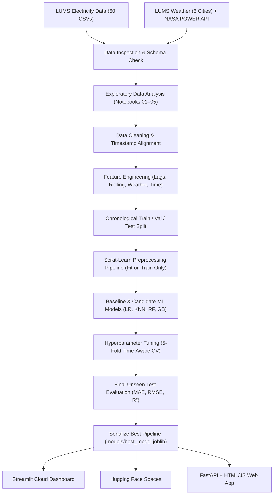

# ⚡ BijliCast — Master Architecture & Implementation Plan

> **Weather-Aware Household Electricity Consumption Forecasting in Pakistan**  
> *A professional, reproducible Machine Learning blueprint mapped directly to CT-378 guidelines.*


-informational)

---

## 📋 Project Overview

Every folder in this repository has a clear, single responsibility designed for reproducibility and viva defense. 

| Attribute | Specification |
| :--- | :--- |
| **Project Name** | **BijliCast** — Weather-Aware Household Electricity Consumption Forecasting |
| **Course Alignment** | CT-378 Machine Learning Project Guidelines |
| **Data Source 1** | **LUMS REWD-P** (60 household electricity CSVs & 6 city weather CSVs) |
| **Data Source 2** | **NASA POWER** (Hourly meteorological data, used after verifying LUMS coverage) |
| **ML Task** | Supervised Time-Series Regression |
| **Target Variable** | `next_hour_energy_kwh` |
| **Core Tech Stack** | Python, Pandas, NumPy, Matplotlib, Seaborn, Scikit-learn, Joblib |
| **Deployment Stack** | Streamlit Community Cloud, Hugging Face Spaces (Gradio/Streamlit), FastAPI + HTML/CSS/JS |

---

## 📑 Table of Contents

1. [Complete Project Folder Structure](#1-complete-project-folder-structure)
2. [Directory Breakdown & Responsibilities](#2-directory-breakdown--responsibilities)
   - [A. `data/` — Dataset Storage](#a-data--dataset-storage)
   - [B. `notebooks/` — ML Experimentation Laboratory](#b-notebooks--ml-experimentation-laboratory)
   - [C. `src/` — Reusable Python Implementation](#c-src--reusable-python-implementation)
   - [D. `models/` — Saved Trained Models](#d-models--saved-trained-models)
   - [E. `reports/` — EDA Plots, Results & Final Report](#e-reports--eda-plots-results--final-report)
   - [F. `app/` — Three Deployment Applications](#f-app--three-deployment-applications)
   - [G. `tests/` — Testing & Reliability](#g-tests--testing--reliability)
3. [Root-Level Configuration Files](#3-root-level-configuration-files)
4. [System Architecture & Workflow](#4-system-architecture--workflow)
5. [Academic & Reproducibility Best Practices](#5-academic--reproducibility-best-practices)
6. [CT-378 Rubric & Viva Reference Map](#6-ct-378-rubric--viva-reference-map)
7. [Phased Implementation Tracker (0/30)](#7-phased-implementation-tracker)
8. [Immediate Next Steps](#8-immediate-next-steps)

---

## 1. Complete Project Folder Structure

> [!NOTE]
> You do not need to create every empty file immediately. This is our target architectural blueprint, which we will build progressively across six phases.

```text
BijliCast/
│
├── data/
│   ├── DATA_SOURCES.md
│   ├── raw/
│   │   ├── lums/
│   │   │   ├── electricity/
│   │   │   │   ├── household_01.csv
│   │   │   │   ├── household_02.csv
│   │   │   │   └── ... household_60.csv
│   │   │   │
│   │   │   └── weather/
│   │   │       ├── karachi.csv
│   │   │       ├── lahore.csv
│   │   │       ├── multan.csv
│   │   │       ├── peshawar.csv
│   │   │       ├── islamabad.csv
│   │   │       └── skardu.csv
│   │   │
│   │   └── nasa_power/
│   │       ├── karachi.csv
│   │       ├── lahore.csv
│   │       ├── multan.csv
│   │       ├── peshawar.csv
│   │       ├── islamabad.csv
│   │       └── skardu.csv
│   │
│   ├── interim/
│   │   ├── cleaned_electricity.csv
│   │   ├── cleaned_lums_weather.csv
│   │   └── cleaned_nasa_weather.csv
│   │
│   └── processed/
│       ├── merged_dataset.csv
│       ├── features_dataset.csv
│       ├── train.csv
│       ├── validation.csv
│       └── test.csv
│
├── notebooks/
│   ├── 01_data_understanding.ipynb
│   ├── 02_electricity_eda.ipynb
│   ├── 03_weather_eda.ipynb
│   ├── 04_data_integration.ipynb
│   ├── 05_integrated_eda.ipynb
│   ├── 06_preprocessing_feature_engineering.ipynb
│   ├── 07_data_splitting.ipynb
│   ├── 08_baseline_model.ipynb
│   ├── 09_model_training.ipynb
│   ├── 10_hyperparameter_tuning.ipynb
│   ├── 11_final_evaluation.ipynb
│   └── 12_model_explainability.ipynb
│
├── src/
│   ├── data/
│   │   ├── inspect_data.py
│   │   ├── clean_data.py
│   │   ├── collect_nasa.py
│   │   └── merge_data.py
│   │
│   ├── features/
│   │   └── build_features.py
│   │
│   ├── preprocessing/
│   │   └── pipeline.py
│   │
│   ├── models/
│   │   ├── baseline.py
│   │   ├── train.py
│   │   ├── tune.py
│   │   └── evaluate.py
│   │
│   └── utils/
│       └── config.py
│
├── models/
│   ├── baseline_model.joblib
│   ├── best_model.joblib
│   └── model_metadata.json
│
├── reports/
│   ├── figures/
│   ├── tables/
│   └── BijliCast_Report.pdf
│
├── app/
│   ├── streamlit/
│   │   └── app.py
│   │
│   ├── huggingface/
│   │   ├── app.py
│   │   └── README.md
│   │
│   └── api/
│       ├── main.py
│       ├── schemas.py
│       └── static/
│           ├── index.html
│           ├── style.css
│           └── script.js
│
├── tests/
│   ├── test_data.py
│   ├── test_features.py
│   └── test_api.py
│
├── .gitignore
├── requirements.txt
├── README.md
└── LICENSE
```

---

## 2. Directory Breakdown & Responsibilities

### A. `data/` — Dataset Storage
*Maps to CT-378: Data Requirements*

This directory houses all original, intermediate, and transformed datasets across three isolated stages:

#### 1. `data/raw/` — Immutable Original Datasets
* `raw/lums/electricity/`: The 60 original household consumption CSV files.
* `raw/lums/weather/`: The 6 city weather CSV files provided with LUMS.
* `raw/nasa_power/`: Hourly meteorological CSV files retrieved via the NASA POWER API.

> [!CAUTION]
> **Golden Rule of Reproducibility:** Never modify original `raw/` files in place. They must remain completely untouched so the pipeline can always be re-run from scratch.

#### 2. `data/interim/` — Cleaned Intermediate Datasets
Stores datasets after type correction, timestamp standardization, and removal of corrupt records, prior to merging:
* `cleaned_electricity.csv`
* `cleaned_lums_weather.csv`
* `cleaned_nasa_weather.csv`

#### 3. `data/processed/` — Final ML-Ready Datasets
Stores integrated datasets and engineered features.

| File | Purpose |
| :--- | :--- |
| `merged_dataset.csv` | Timestamp-aligned electricity + weather records combined |
| `features_dataset.csv` | Dataset containing lag, rolling, temporal, and weather features |
| `train.csv` | Chronologically earlier training period *(optional saved artifact)* |
| `validation.csv` | Chronological validation period *(optional saved artifact)* |
| `test.csv` | Final unseen testing period *(optional saved artifact)* |

> [!IMPORTANT]
> **Preventing Data Leakage:** Learned transformations (imputation, encoding, scaling) must **never** be computed on the full `processed/` dataset prior to splitting. Those belong strictly inside the training-fitted `scikit-learn` pipeline.

---

### B. `notebooks/` — ML Experimentation Laboratory
*Maps to CT-378: Complete ML Lifecycle*

Jupyter notebooks combine code, statistical tables, visualizations, and narrative explanations. Having dedicated notebooks makes defending your work during the viva straightforward.

| Notebook | Core Responsibility |
| :--- | :--- |
| `01_data_understanding.ipynb` | Inspect CSV schemas, dimensions, columns, data types, and timestamp granularity. |
| `02_electricity_eda.ipynb` | Analyze household electricity consumption trends, seasonality, and anomalies. |
| `03_weather_eda.ipynb` | Analyze city-level weather distributions and meteorological patterns. |
| `04_data_integration.ipynb` | Merge LUMS electricity, LUMS weather, and NASA POWER datasets on aligned timestamps. |
| `05_integrated_eda.ipynb` | Study correlations and nonlinear relationships between weather and electricity usage. |
| `06_preprocessing_feature_engineering.ipynb` | Prototype imputation, encoding, scaling, lag variables, and rolling window features. |
| `07_data_splitting.ipynb` | Execute chronological `train` / `validation` / `test` splits without temporal leakage. |
| `08_baseline_model.ipynb` | Build and evaluate a naive forecasting benchmark (e.g., `lag_1` or `lag_24`). |
| `09_model_training.ipynb` | Train and compare at least 3 distinct ML regression algorithms. |
| `10_hyperparameter_tuning.ipynb` | Optimize top candidate models using `GridSearchCV` / `RandomizedSearchCV` with time-aware CV. |
| `11_final_evaluation.ipynb` | Compute final test-set metrics (**MAE, RMSE, R²**) and perform residual error analysis. |
| `12_model_explainability.ipynb` | Extract feature importances and interpret model drivers *(optional enhancement)*. |

---

### C. `src/` — Reusable Python Implementation
*Production-Quality Modular Code*

While notebooks are for interactive exploration, `src/` holds clean, modular Python functions imported across both your notebooks and deployment web apps.

#### 1. `src/data/` — Ingestion & Cleaning
| Script | Responsibility |
| :--- | :--- |
| `inspect_data.py` | Programmatically validate columns, data types, dimensions, and date ranges. |
| `clean_data.py` | Handle invalid readings, parse timestamps, and standardize units. |
| `collect_nasa.py` | Automatically fetch hourly weather data for all 6 cities via the NASA POWER API. |
| `merge_data.py` | Join household electricity consumption with city weather records. |

#### 2. `src/features/build_features.py` — Feature Engineering
Generates temporal, historical lag, and meteorological predictors:

| Feature Name | Category | Description |
| :--- | :--- | :--- |
| `hour` | Temporal | Hour of the day (`0–23`) |
| `day_of_week` | Temporal | Day of the week (`0–6`) |
| `month` | Temporal | Month of the year (`1–12`) |
| `lag_1` | Historical Lag | Previous hour's consumption ($t-1$) |
| `lag_24` | Historical Lag | Consumption 24 hours ago ($t-24$) |
| `rolling_mean_24` | Rolling Window | Average consumption over the past 24 hours |
| `temperature` | Weather | Current ambient temperature |
| `humidity` | Weather | Current relative humidity |
| `solar_radiation` | Weather | Current solar irradiance |

> [!WARNING]
> **Strict Temporal Causality:** Lag and rolling features must strictly use past observations ($\le t$). The target `next_hour_energy_kwh` ($t+1$) must be shifted into the future and never leaked into input features.

#### 3. `src/preprocessing/pipeline.py` — Scikit-Learn Pipeline
Encapsulates `SimpleImputer`, `OneHotEncoder`, `StandardScaler`, and `ColumnTransformer` into a unified pipeline:

```python
from sklearn.pipeline import Pipeline
from sklearn.impute import SimpleImputer
from sklearn.preprocessing import StandardScaler, OneHotEncoder
from sklearn.compose import ColumnTransformer

numeric_pipeline = Pipeline([
    ("imputer", SimpleImputer(strategy="median")),
    ("scaler", StandardScaler())
])

categorical_pipeline = Pipeline([
    ("imputer", SimpleImputer(strategy="most_frequent")),
    ("encoder", OneHotEncoder(handle_unknown="ignore"))
])

preprocessor = ColumnTransformer([
    ("numeric", numeric_pipeline, numeric_features),
    ("categorical", categorical_pipeline, categorical_features)
])
```
*Principle: Fit exclusively on training data; during cross-validation, fitting occurs isolated inside each fold.*

#### 4. `src/models/` — Training, Tuning & Evaluation
| Script | Responsibility |
| :--- | :--- |
| `baseline.py` | Implement naive persistence baseline ($y_{t+1} = y_t$ or $y_{t-23}$) and simple regression baseline. |
| `train.py` | Train candidate ML regressors wrapped in the preprocessing pipeline. |
| `tune.py` | Run hyperparameter search with 5-fold cross-validation. |
| `evaluate.py` | Compute MAE, RMSE, and $R^2$ scores and generate diagnostic plots. |

**Candidate Algorithms for BijliCast:**
1. **Naive Persistence Baseline:** Predicts previous hour's consumption or same hour yesterday.
2. **Linear Regression:** Fast, interpretable parametric baseline.
3. **K-Nearest Neighbors (KNN) Regressor:** Captures local similarity in historical weather/usage states.
4. **Random Forest Regressor:** Bagging ensemble capable of modeling complex non-linear interactions.
5. **Gradient Boosting Regressor:** Sequential boosting ensemble optimizing residual forecasting errors.

---

### D. `models/` — Saved Trained Models
*Final Serialized ML Artifacts*

* `baseline_model.joblib`: Serialized baseline benchmark model.
* `best_model.joblib`: The winning, fully fitted pipeline (Preprocessing + Regressor).
* `model_metadata.json`: Tracks algorithm name, training timestamp, exact feature list, dataset version, and validation/test metrics.

```python
import joblib

# Instant inference in production apps without retraining
model = joblib.load("models/best_model.joblib")
prediction = model.predict(input_dataframe)
```

> [!IMPORTANT]
> Select `best_model.joblib` strictly using **Validation / Cross-Validation** performance. Evaluate on the unseen **Test Set** only once at the very end.

---

### E. `reports/` — EDA Plots, Results & Final Report
*Maps to CT-378: Project Report (3 Marks)*

#### 1. `reports/figures/`
High-resolution plots exported for the PDF report, presentation slides, and web dashboards:
* `electricity_distribution.png`
* `hourly_consumption.png`
* `missing_values.png`
* `outlier_boxplot.png`
* `weather_distribution.png`
* `correlation_heatmap.png`
* `weather_vs_consumption.png`
* `actual_vs_predicted.png`

#### 2. `reports/tables/`
CSV summaries (`dataset_summary.csv`, `missing_values_summary.csv`, `model_comparison.csv`).

**Model Comparison Template (`model_comparison.csv`):**
| Model | Validation MAE | Validation RMSE | Test MAE | Test RMSE | Test R² |
| :--- | :---: | :---: | :---: | :---: | :---: |
| Naive Baseline | TBD | TBD | TBD | TBD | TBD |
| Linear Regression | TBD | TBD | TBD | TBD | TBD |
| KNN Regressor | TBD | TBD | TBD | TBD | TBD |
| Random Forest Regressor | TBD | TBD | TBD | TBD | TBD |
| Gradient Boosting Regressor | TBD | TBD | TBD | TBD | TBD |

#### 3. `reports/BijliCast_Report.pdf`
Final 3–4 page academic report covering:
1. Abstract
2. Problem Statement & Motivation
3. Data Collection & Sources
4. Exploratory Data Analysis (EDA)
5. Methodology & Preprocessing Pipeline
6. Experimental Results & Model Comparison
7. Deployment Architecture & Screenshots
8. Limitations & Future Work
9. References
10. Individual Team Contribution Table

---

### F. `app/` — Three Deployment Applications
*Live Demonstration & Deliverables*

> [!NOTE]
> While the project brief mentions *"choose any one"* in the text description, the deliverables checklist and marking rubric assess **all three deployment platforms**. We will build all three to guarantee full marks.

#### 1. Streamlit Dashboard (`app/streamlit/app.py`)
* **Host:** Streamlit Community Cloud
* **Features:** City selector, household profile selector, weather inputs, historical consumption inputs, **"Predict"** action button, predicted output in **kWh** (with optional prediction intervals), and an interactive Actual vs. Predicted chart.

#### 2. Hugging Face Space (`app/huggingface/`)
* **Host:** Hugging Face Hub + Spaces (Gradio or Streamlit SDK)
* **Files:** `app.py` and `README.md` (Model Card detailing dataset, metrics, intended use, and limitations).

#### 3. FastAPI Local Web Application (`app/api/`)
* **Host:** Localhost (`uvicorn app.api.main:app --reload`) for live viva demonstration.
* **Components:**
  * `main.py`: FastAPI backend serving `/predict` and static files.
  * `schemas.py`: Strict `Pydantic` input validation (rejecting invalid cities or physically impossible weather values) and response models.
  * `static/`: Clean `index.html`, `style.css`, and `script.js` (`fetch` POST request to `/predict`).

---

### G. `tests/` — Testing & Reliability
*Automated Quality Assurance*

| Test File | Verification Scope |
| :--- | :--- |
| `test_data.py` | Verifies dataset loading, expected column schemas, non-empty frames, and timestamp continuity. |
| `test_features.py` | Verifies lag shifts (`lag_1`, `lag_24`), rolling window accuracy, and guarantees zero target leakage. |
| `test_api.py` | Tests FastAPI `/predict` status codes, valid JSON predictions, and graceful `422` error handling on bad inputs. |

---

## 3. Root-Level Configuration Files

### `requirements.txt`
Pinned dependencies for reproducible environment creation *(versions will be locked after final testing)*:
```txt
pandas==2.2.3
numpy==2.1.3
scikit-learn==1.6.1
matplotlib==3.10.0
seaborn==0.13.2
joblib==1.4.2
streamlit==1.41.1
fastapi==0.115.6
uvicorn==0.34.0
pydantic==2.10.4
requests==2.32.3
gradio==5.9.1
jupyter==1.1.1
pytest==8.3.4
```

### `.gitignore`
Prevents clutter, virtual environments, and restricted raw data from bloating the repository:
```gitignore
# Byte-compiled / cache
__pycache__/
*.pyc
.ipynb_checkpoints/
.pytest_cache/

# Environments & secrets
.venv/
venv/
.env

# OS files
.DS_Store
Thumbs.db

# Large raw datasets (use scripts + DATA_SOURCES.md to reproduce)
data/raw/

# Temporary files
*.tmp
```

### `README.md`
The front page of the repository containing:
1. Project Title & Executive Summary
2. Problem Statement, Motivation & Objectives
3. Dataset Sources, Licences & Collection Methodology
4. End-to-End ML Methodology
5. Key EDA Visualizations
6. Model Comparison Table & Final Test Results
7. Local Installation & Environment Setup Instructions
8. Commands to Run Streamlit, Hugging Face App, FastAPI, and Tests
9. Live Deployment Links (Streamlit Cloud + Hugging Face Spaces)
10. Team Members & Individual Contributions

### `LICENSE`
Open-source license (e.g., MIT License) governing the **project code**. *(Note: LUMS REWD-P and NASA POWER datasets remain governed by their respective provider licenses).*

---

## 4. System Architecture & Workflow



---

## 5. Academic & Reproducibility Best Practices

### A. Dataset Documentation (`data/DATA_SOURCES.md`)
Explicitly documents provenance and licensing to satisfy CT-378 data governance criteria:

| Attribute | LUMS REWD-P | NASA POWER |
| :--- | :--- | :--- |
| **Provider** | LUMS Energy Institute | NASA Langley Research Center |
| **Data Type** | Household electricity + city weather | Hourly meteorological parameters |
| **Collection Method** | Downloaded CSV archive | Automated REST API (`src/data/collect_nasa.py`) |
| **Collection Date** | *Record actual date* | *Record actual date* |
| **Licence / Terms** | Verify LUMS usage & redistribution terms | NASA Open Data Policy |
| **Geographic Scope** | 6 Pakistani Cities (60 Households) | Matching coordinates for the 6 cities |

### B. Handling Large Datasets on GitHub
* Do not push gigabytes of raw CSVs or violate household data redistribution terms.
* Keep `data/raw/` local and ignored via `.gitignore`.
* Provide automated retrieval scripts (`collect_nasa.py`) and clear step-by-step download placement instructions in `data/DATA_SOURCES.md`.

### C. Pragmatic Execution
* Focus on core rubric deliverables first before optional enhancements (like `12_model_explainability.ipynb`).

---

## 6. CT-378 Rubric & Viva Reference Map

Use this quick-reference lookup table when answering instructor questions during your viva:

| Instructor / Rubric Requirement | Exact Repository Location |
| :--- | :--- |
| **Data Collection & Scripts** | `data/raw/`, `src/data/collect_nasa.py` |
| **Data-Source Documentation** | `data/DATA_SOURCES.md` |
| **EDA (5+ Meaningful Plots)** | `notebooks/02` to `05`, `reports/figures/` |
| **Missing Values & Outlier Analysis** | `notebooks/02_electricity_eda.ipynb`, `03_weather_eda.ipynb` |
| **Preprocessing Pipeline** | `src/preprocessing/pipeline.py`, `notebooks/06_*.ipynb` |
| **Feature Engineering (15+ Features)** | `src/features/build_features.py`, `notebooks/06_*.ipynb` |
| **Chronological Train/Val/Test Split** | `notebooks/07_data_splitting.ipynb` |
| **Baseline Forecasting Model** | `src/models/baseline.py`, `notebooks/08_baseline_model.ipynb` |
| **Three or More ML Algorithms** | `src/models/train.py`, `notebooks/09_model_training.ipynb` |
| **5-Fold Cross-Validation & Tuning** | `src/models/tune.py`, `notebooks/10_hyperparameter_tuning.ipynb` |
| **Final Evaluation (MAE, RMSE, R²)** | `src/models/evaluate.py`, `notebooks/11_final_evaluation.ipynb` |
| **Saved Model Pipeline** | `models/best_model.joblib`, `models/model_metadata.json` |
| **Dependency Version Pinning** | `requirements.txt` |
| **Deployment 1: Streamlit** | `app/streamlit/app.py` |
| **Deployment 2: Hugging Face** | `app/huggingface/app.py`, `app/huggingface/README.md` |
| **Deployment 3: FastAPI + Frontend** | `app/api/main.py`, `app/api/schemas.py`, `app/api/static/` |
| **Automated Unit & API Tests** | `tests/test_data.py`, `tests/test_features.py`, `tests/test_api.py` |
| **Final 3–4 Page PDF Report** | `reports/BijliCast_Report.pdf` |
| **Setup Guide & Live Links** | `README.md` |

---

## 7. Phased Implementation Tracker

Track progress by checking off items (`- [x]`) as we complete each milestone. **Current Progress: 0/30**

### Phase 1 — Dataset Understanding
- [ ] 1. Create the `BijliCast` repository and core folder skeleton
- [ ] 2. Organize the 60 LUMS electricity CSVs inside `data/raw/lums/electricity/`
- [ ] 3. Organize the 6 LUMS weather CSVs inside `data/raw/lums/weather/`
- [ ] 4. Inspect columns, data types, timestamp granularity, and row counts (`01_data_understanding.ipynb`)
- [ ] 5. Verify data sources, date ranges, and document `data/DATA_SOURCES.md`

### Phase 2 — Exploratory Data Analysis (EDA)
- [ ] 6. Complete Household Electricity EDA (`02_electricity_eda.ipynb`)
- [ ] 7. Complete City Weather EDA (`03_weather_eda.ipynb`)
- [ ] 8. Perform comprehensive missing-value and outlier analysis
- [ ] 9. Complete Integrated Electricity + Weather EDA (`05_integrated_eda.ipynb`)
- [ ] 10. Export at least 5 publication-quality plots to `reports/figures/`

### Phase 3 — Dataset Preparation & Feature Engineering
- [ ] 11. Retrieve NASA POWER hourly data if needed to fill LUMS weather gaps (`collect_nasa.py`)
- [ ] 12. Clean datasets, standardize timezones, and align hourly timestamps (`clean_data.py`)
- [ ] 13. Integrate electricity and weather datasets (`merge_data.py`, `04_data_integration.ipynb`)
- [ ] 14. Engineer temporal, lag, rolling, and weather features (`build_features.py`, `06_*.ipynb`)
- [ ] 15. Verify dataset meets scale requirements (**5,000+ rows** and **15+ features**)

### Phase 4 — Machine Learning & Evaluation
- [ ] 16. Build leak-free `scikit-learn` preprocessing pipeline (`src/preprocessing/pipeline.py`)
- [ ] 17. Execute chronological train/validation/test split (`07_data_splitting.ipynb`)
- [ ] 18. Train and log the naive & linear baseline models (`08_baseline_model.ipynb`)
- [ ] 19. Train at least 3 distinct ML regression algorithms (`09_model_training.ipynb`)
- [ ] 20. Perform hyperparameter tuning with 5-fold cross-validation (`10_hyperparameter_tuning.ipynb`)
- [ ] 21. Run final evaluation on the untouched test set and export metrics (`11_final_evaluation.ipynb`)

### Phase 5 — Multi-Platform Deployment
- [ ] 22. Serialize final winning pipeline (`models/best_model.joblib`) and `model_metadata.json`
- [ ] 23. Build and deploy the Streamlit application (`app/streamlit/app.py`)
- [ ] 24. Build and deploy the Hugging Face Space (`app/huggingface/`)
- [ ] 25. Build the FastAPI backend + HTML/CSS/JS frontend (`app/api/`)
- [ ] 26. Run unit and API validation tests across all deployments (`tests/`)

### Phase 6 — Final Documentation & Viva Prep
- [ ] 27. Write and compile the 3–4 page PDF report (`reports/BijliCast_Report.pdf`)
- [ ] 28. Finalize root `README.md` with setup instructions, visuals, and live deployment links
- [ ] 29. Rehearse the live end-to-end application demonstration
- [ ] 30. Prepare individual team members for viva defense questions using Section 6

---

## 8. Immediate Next Steps

Before writing feature engineering or modeling code, we must verify the exact physical schema of the raw LUMS files:
1. Determine whether the LUMS electricity measurements are recorded at **1-minute**, **15-minute**, or **1-hour** intervals (which dictates how we aggregate consumption to define `next_hour_energy_kwh`).
2. Inspect the exact column names, units, and date coverage of the 6 LUMS city weather CSVs.
3. Identify any missing meteorological variables or timestamp gaps that require supplementation from **NASA POWER**.

> [!TIP]
> **Action Required to Start Phase 1:**  
> Inspect **one sample LUMS electricity CSV** and **one sample LUMS weather CSV** to lock in the exact column names and timestamp format before implementing `01_data_understanding.ipynb`.